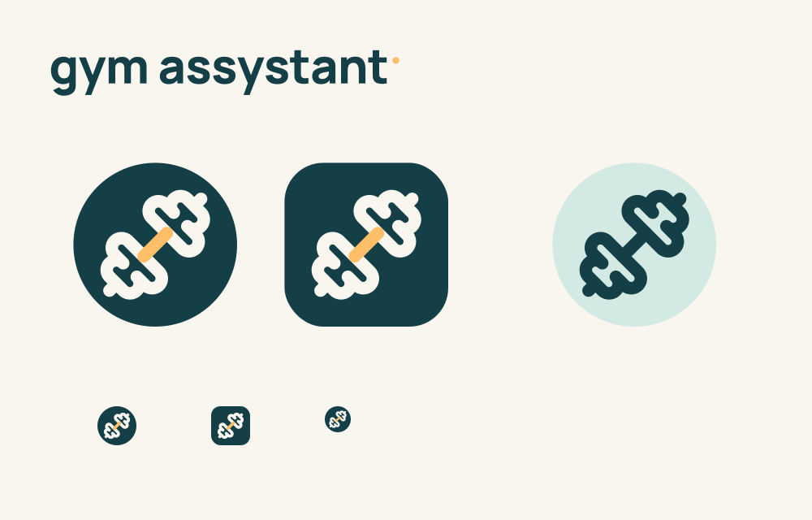
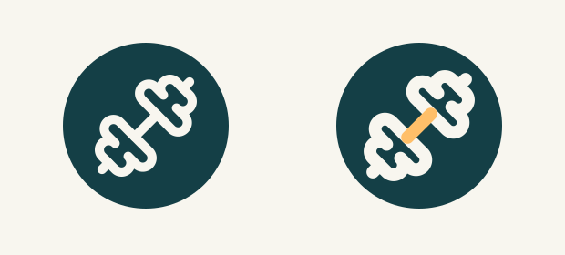

# gym assystant logo

Revision 35, GYM-007/013/015/025/027. The user selected a dumbbell symbol after comparing it with a typographic monogram. The final mark adapts the openly licensed Lucide dumbbell with a **30% heavier, 2.6-unit stroke**, rounded caps/joins and an amber connecting bar. Its substantial strokes and open counters complement Manrope ExtraBold, the app's heading font. Deep teal `#143F46`, ivory `#F8F6EF` and sunrise amber `#FFBF69` retain the approved palette.

- [dumbbell-symbol.svg](dumbbell-symbol.svg): transparent vector foreground, 108 × 108 coordinate space.
- [wordmark.svg](wordmark.svg): outlined Manrope800 full **gym assystant** name, dark text for light backgrounds.
- [Android foreground](../../../android/app/src/main/res/drawable/ic_gym_foreground.xml): identical dumbbell paths, stroke and placement, with no runtime font dependency.
- [API26 adaptive icon](../../../android/app/src/main/res/mipmap-anydpi-v26/ic_launcher.xml) and [API33 themed variant](../../../android/app/src/main/res/mipmap-anydpi-v33/ic_launcher.xml): shared foreground, existing teal background; themed icons use the foreground's alpha silhouette.

Android supplies the launcher mask; the foreground has no baked-in background, corner radius or shadow. The symbol scales the original 24-unit geometry by 2.12 and centers it within the 108dp layer. A 1080px transparent render verifies ink bounds approximately `(29.8, 29.8)–(78.2, 78.2)` and maximum radius31.256dp, inside the centered 66dp safe circle. The review board shows circular/rounded-square masks, 48px/32px examples, and an illustrative monochrome tint. The full-name asset keeps the exact spelling. The in-app text wordmark continues using the same font.

## Open vector search and attribution

On 14 October 2026, reviewed [Google Material icons](https://github.com/google/material-design-icons) (Apache 2.0) and [Lucide](https://lucide.dev/) (ISC). Selected [Lucide's official dumbbell SVG](https://github.com/lucide-icons/lucide/blob/main/icons/dumbbell.svg), downloaded unchanged as [lucide-dumbbell.svg](references/lucide-dumbbell.svg). Download SHA-256: `058a51e1fd42319d7eee4988a68bee4a23bc94fc69cb8aa1450835246126382d`.

The adapted symbol preserves Lucide's path geometry; changes are stroke weight, colors, size and placement. Its complete upstream [ISC/MIT notice](references/lucide-LICENSE) is retained, and an identical [license resource](../../../android/app/src/main/res/raw/lucide_license.txt) is bundled in the APK. Copyright (c) 2026 Lucide Icons and Contributors. Open artwork was available, so no generated replacement fitness illustration was needed.

The wordmark outlines derive from the bundled [Manrope font](../../../android/app/src/main/res/font/manrope.ttf), SHA-256 `3ae11c49db0455a3cc33e37d380f20fdb8c7f8b41dc07625c177e3d87a9d6ae6`; its [OFL notice](../../../android/app/src/main/res/raw/manrope_ofl.txt) remains bundled. Rendering either SVG requires no installed font or network access.

References: [Android adaptive-icon guidance](https://developer.android.com/develop/ui/compose/system/icon_design_adaptive), [shared native typography](../native-ui-components.md), [brand evidence](../../research/branding-research.md). Styling matches the approved brand; no claim is made that this logo increases exercise adherence.

Validation: vector geometry and small-size previews inspected. Build/lint and installed launcher observations are recorded in [traceability](../../product/traceability.md#native-logo--revision-35). The monochrome board is illustrative; actual themed-launcher/OEM behavior remains a device-verification gap.
