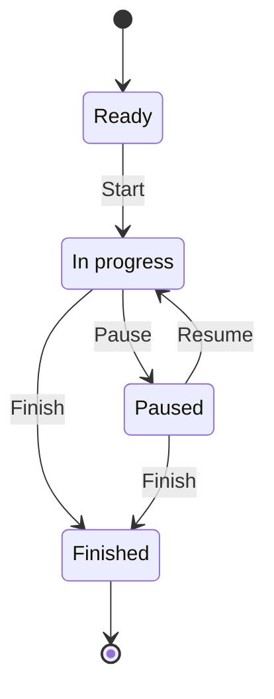

# gym assystant — draft specification

Status: revision 36, native implementation authorized and implemented; verification is recorded separately. The offline Android plan has been presented. The browser mockup remains the visual reference; native coverage is recorded separately and only after its implementation and checks exist.

## Mockup alignment (revision 36)

- GYM-006/007/013/025: display the approved dumbbell logo in the mockup page's desktop branding, browser icon and external view-reference strip. Reuse the Android symbol's vector paths, colors and heavier stroke; preserve its license. Decorative marks do not duplicate the spoken app name or add navigation actions. The phone header follows the implemented Android text wordmark. Verify both themes, desktop and 320/390/430px widths without clipping or reducing app controls.
- GYM-001/004/009/012/014/015/017/018/019/025: future browser previews are read-only, with no session lifecycle, logging, warm-up, reorder or timer execution actions. Match native Pause-before-Finish order, persistent planning library/detail headers and labelled Remove exercise actions.
- GYM-010/015/025: Progress exposes Setup and Reference weight (kg) dropdowns beside one another. Options come from comparable sample history; reference weights include valid completed working sets only. Choose a recorded weight explicitly for reps; absent reference shows an unavailable comparison. Preserve chosen references per exercise/setup while navigating, exclude changed-context records, and reset plot exploration when context changes. Fictional history remains labelled and separate from live demo edits.
- GYM-010/025: keep the 180px plot and 48px exploration targets readable. Comparison controls appear above the plot; when the added row or an unavailable-comparison explanation exceeds the visible height, vertical scrolling reveals the full chart and guidance, following the native Progress screen.
- Review the browser's current screens against the implemented native UI and align material visible labels, hierarchy and controls. Keep the explicitly fictional data, disposable storage/file/video previews and external view IDs; record platform-specific differences and actual review limits.

## Native logo refinement (revision 35)

- GYM-007/013: replace the Android launcher's generic program glyph with an openly licensed dumbbell symbol, restyled with a heavier stroke and rounded joins to match bundled Manrope ExtraBold (weight 800). Use the existing deep-teal, ivory and sunrise-amber palette, with an amber connecting bar. Preserve the exact app name. Provide reusable SVG assets for the symbol and outlined full-name wordmark, with no external font dependency when rendered; preserve the symbol's upstream license and source attribution.
- GYM-015/025/027: use native adaptive foreground/background layers, keep the mark inside the mask-safe area, and provide a monochrome layer for supported themed launchers. Verify circular/rounded masks and small-size legibility, build the APK, and inspect the installed launcher icon. This visual refinement adds no runtime setting or network dependency.

## Native implementation acceptance refinements (revision 34)

These refinements apply to the native app; the disposable browser's fictional data and reload behavior remain unchanged.

- GYM-007/009/013/015/021/025: reproduce the approved mockup as closely as practical at matching logical viewport sizes, including bundled DM Sans/Manrope typography, palette, spacing, card dimensions, component emphasis and screen hierarchy. Translate CSS geometry to dp/sp; use native Material controls with shared styling rather than duplicating each screen's controls. System bars, keyboard and system file pickers follow Android. Check native screenshots against current previews; do not claim visual parity from compilation alone.
- GYM-001/003/004/005/008/012/014/016/017/018/019/020/022/026/028: native plans, retained drafts, original dated prescriptions, exercise order, sets, setup, lifecycle, attendance and settings survive process recreation and relaunch. Actual reps/kg start unrecorded, not at fictional sample values. Future previews cannot record performance or run a real session. Ready/Paused logging and Finished read-only rules remain as specified; session actions stay on the session screen only.
- GYM-010/020: the user selected immediate inclusion of qualifying completed working sets, including unfinished sessions. Undo removes the set from derived performance; warm-ups and invalid/unrecorded values never qualify. Attendance retains the first qualifying visit date and the original planned date. Real history starts empty; show missing comparisons truthfully. Group comparisons by stable exercise/machine identity and setup, label real comparisons unadjusted because effort/ROM are not collected. Choose reference kg explicitly from recorded comparable weights; no invented reference load.
- GYM-002/027: begin with user-supplied local video files, imported to app-owned storage and played in-app without autoplay; associate each clip with its exercise definition. When absent, the secondary video panel offers local import. No streaming, demo-placeholder playback, licensed clip claims or remote source is added.
- GYM-012/024: native timers use monotonic elapsed time and boot identity. Background/process recreation on the same boot retains elapsed time; a changed/unverifiable boot pauses at the last durable reading and explains the interruption. Session Pause/Finish settle all occurrence timers. No foreground service, alert or automatic transition is added.
- GYM-023/024/027: Room is the private transactional authority. Full UTF-8 JSON generations, CSV and a TXT dictionary/recovery guide are independently readable; a local folder failure never loses the private log. Initial implementation uses one versioned dataset row and a durable backup revision rather than duplicating every domain record across SQL and interchange models; split storage only when measured size/query needs warrant it. Preserve two verified app-owned backup generations before pruning older ones. No destructive database fallback, cloud backup, Internet permission, explicit restore UI or definition editing/deletion is introduced.

## Purpose

Follow a training program made of multiple training sessions. During each session, prioritize logging repetitions and weight, time execution and recovery, retain machine setup notes, and offer secondary access to an exercise video. Review performance across comparable sessions and see which session is planned today and on future dates.

## Requirements and acceptance criteria

| ID | Requirement | Acceptance criteria |
| --- | --- | --- |
| GYM-001 | Select exercises within a session. | Each session shows its exercises. Selecting an exercise opens its own log; back returns to the correct session. |
| GYM-002 | Secondary in-app exercise video access. | A small button below logging, timers, and setup opens the selected exercise's video panel. No large thumbnail or autoplay. The mockup labels the panel as a non-playable placeholder with a neutral decorative video frame. The mockup does not play video; native playback follows the revision-34 refinements above. |
| GYM-003 | Record seat position per exercise occurrence. | Free text persists while navigating during the mockup visit. Separate sessions have separate notes; cross-session carryover is undecided. |
| GYM-004 | Record reps and weight for each set. | Reps are prominent and appear before weight. Reps accept nonnegative integers; kg accepts nonnegative finite numbers. Invalid input restores the last valid value. Values remain associated with the exercise occurrence. Sample values are not prescriptions. |
| GYM-005 | Mark sets done and undone. | Completion counts update in exercise and session views. Native completion follows the revision-34 persistence and history rules above. |
| GYM-006 | Explore a responsive dummy mockup. | Narrow phone and desktop layouts, visible prototype disclosure, keyboard access and focus restoration. All app-owned popups, including video and folder dialogs, stay within the simulated phone display on desktop and mobile. Modal cards are centered in that display with at least 16px edge spacing; only the phone is dimmed, and the surrounding presentation stays undimmed. Long dialog content scrolls inside the card rather than escaping the phone. Retain native modal focus trapping, Escape/close/backdrop dismissal and trigger focus restoration; adapt to resize and page scrolling without changing app data. The overflow menu remains anchored inside the phone header. These are production-style mockup presentations, not native Android delivery. Edits and timers are in memory and reset on reload; statistics are labeled fictional history. |
| GYM-007 | Name the app gym assystant. | Browser title and visible branding use this exact spelling. |
| GYM-008 | Center the app on a training program containing sessions. | Home identifies the active program; its session templates are accessible through the calendar and upcoming agenda. The initial sample still has three distinct templates. Each defines ordered exercises, number of sets, and target rep ranges. Selecting a session shows those prescriptions separately from actual logged sets. Train, Plan, and Progress are persistent bottom navigation destinations; Settings is reached through the top-right overflow menu. Train opens dated workouts; Plan edits their reusable templates. |
| GYM-009 | Prioritize performance logging. | VIEW-003 starts with the exercise name beside the Back arrow in the same heading row. Only Paused/Finished status appears below the heading when needed; no session lifecycle action or empty action row appears in VIEW-003. Compact execution/recovery timers follow at the top, then the prescribed target, one combined warm-up/working-set list with reps/weight controls and an inline Add warm-up action, machine setup, and a small video button. The exercise name appears only once and wraps within the phone width; Back retains its 48px touch target. Set controls are visible before video access at mobile width. |
| GYM-010 | Show training performance statistics. | A Progress view lets the user select an exercise and metric. Lead with dated history for best reps at a fixed weight, heaviest weight at exactly 10 reps, and volume load; also retain completed working-set count for the displayed period in “How to compare”. Values are computed from explicit fictional completed logs, not hardcoded chart labels. No comparable data means a gap, not zero. Use a larger trend plot with a labelled zero-based value axis, units and readable actual dates. Horizontal positions reflect elapsed civil days rather than equal spacing for irregular sessions. Connect only consecutive comparable observations; leave missing data as a visible gap. Tap a session point to show its exact value and full date in the card; give points 48px non-overlapping targets, use internal horizontal panning for closely spaced dates while keeping the value axis visible, and provide keyboard access (Enter/Space, left/right navigation). Selection has a visible ring, vertical inspection guide and pressed semantics. Drag/swipe across the plot to inspect the nearest recorded date continuously, without inventing intermediate observations; vertical scrolling outside a horizontal inspection gesture remains usable. A separate date/timeline lane permits horizontal drag/swipe panning. Provide 48px Zoom in, Zoom out and Reset view controls for temporal detail, with bounded zoom, an accessible zoom status and disabled controls at their limits; Reset restores the default scale and brings the selected observation into view. Zoom changes horizontal time scale only; the zero-based value axis and metric computations stay unchanged. Keyboard Left/Right, Home/End select observations and reveal them; Enter/Space and existing point taps remain supported. Switching metrics and returning to Progress retain selection and horizontal zoom/pan for the same exercise; choosing another exercise resets its exploration view. Empty histories hide exploration controls, and single observations disable zoom. Pointer cancellation ends the gesture cleanly, and navigation must not leave captured pointers or handlers behind. Show explicit empty/unavailable states instead of a blank plot or invented zero. Keep the entire plot visible on entry at 390×844; do not require hovering or a popup. Details and comparison rules are available in “How to compare”. |
| GYM-011 | Research progression metrics before finalizing analytics. | A linked literature brief distinguishes outcomes, workload, and consistency; cites original research and evidence syntheses; records limitations, formulas, and proposed versus included metrics. Research recommendations do not automatically authorize features. |
| GYM-012 | Time execution and recovery separately. | Execution counts up; recovery counts down from the selected planned exercise's recovery duration (whole seconds, 1–3600; default 90). Set this duration in Plan → plan session → exercise prescription and save it with the plan; the workout uses it as the initial countdown and Reset target, without a separate Planned recovery/duration label or editable duration field. VIEW-003 aligns the time value vertically with its Start/Pause/Resume and Reset controls in both modes; meaningful completion/session messages sit below that row so they do not shift the time value. New or untouched previews use the saved prescription, while protected dated workouts retain their original duration through later edits, plan switching and exercise reordering. Each has start/resume, pause, and reset. Recovery stops at zero and announces completion. Timers use elapsed clock time, retain independent state when switching modes/views, and belong to the selected exercise occurrence. Reload resets them. No automatic set completion or automatic transition. |
| GYM-013 | Use an inviting, evidence-informed brand. | Retain the exact name gym assystant. Use the promise “Your pace. Your progress.”, clear next actions, personal progress feedback, and neutral language for rest or unfinished sets. Apply the sunrise-amber, deep-teal, and ivory palette, wordmark, and tone documented in branding-research.md. Warm accents emphasize action, calmer teal surfaces support logging/recovery, and text/control contrast remains readable. No shame, body-transformation promises, streak pressure, or unsupported claims that colors increase exercise adherence. |
| GYM-014 | Track warm-up reps alongside working sets. | Add/remove warm-up sets; edit nonnegative whole-number reps and nonnegative finite kg; mark each done/undone. Show warm-up and working sets together in one list, with a visible type label on every row. Keep their data distinct, retain them when navigating, and exclude warm-ups from working-set completion, records, and all GYM-010 metrics. |
| GYM-015 | Follow Android Material 3 UI conventions. | Use shared Material button styles by emphasis: filled for workout opening, Start/Resume/Finish, timer Start/Pause/Resume, and Save; filled tonal for Plan Add actions; outlined for Pause and for Finish while Paused; text for the inline warm-up action, Today, Reset, and secondary video access. Use standard circular icon Back controls on secondary screens. Use circular icon buttons with consistent 24-pixel SVG icons and accessible action labels for week navigation, 48px exercise drag handles, template removal, and set completion (selected fill plus pressed state). Labels are centered, sentence case, and 14 pixels with medium weight; regular actions have consistent padding and full rounding. Hover/pressed/focus/disabled states are visible, and disabled controls remain inactive. Use joined segmented selectors with tonal selected fill. VIEW-003 timer modes and VIEW-007 metrics use the same reusable single-choice selector for markup, styling, selection and keyboard behavior. Both use centered text without a checkmark, a selected tonal fill, a heavier label and inset underline, and aria-pressed semantics. Arrow Left/Right and Home/End select and focus an option; Tab, Enter/Space and pointer selection remain native. Reuse shared components for repeated UI patterns rather than copying markup or adding view-specific selected styles; view containers may set placement/spacing and application callbacks keep timer/metric state separate. Use rounded cards and dialog, an icon-and-label bottom navigation bar with a selected indicator, and at least 48 × 48 CSS-pixel touch areas for standard controls in the phone mockup. Calendar date cells adapt their width to fit seven columns, retaining at least 48 pixels of height. Keep navigation outside the scrolling content. Real Android delivery must use dp and native Material components. Document official guidance in android-ui.md. |
| GYM-016 | Schedule sessions and browse dated workouts. | Train initially selects today. Selecting a calendar date updates the existing top card with that date, its session (or “No session planned”), and an action opening that dated workout; no popup opens. At a given viewport, the card keeps the same width and fixed height on training days and empty days, so the calendar never shifts when a date is selected. Reserve the action area even when there is no session, without adding a dummy or disabled button. Long names and focus text are limited to two visible lines with full text retained for accessibility; content and the action must stay inside the card. Previous/next week and Today update the same card. All seven Monday–Sunday dates fit in one row without horizontal scrolling. Upcoming-session taps select that date in the same card. Weekly assignments and individual-date overrides are edited in Plan, not in the execution card. The sample starts with A on Monday, B on Wednesday, C on Friday. Dated logs stay isolated. Future dates say “Preview session”; today/past dates say “View session”. Reload resets edits. |
| GYM-017 | Start, pause, resume, and finish a session. | Each dated session has Ready, In progress, Paused, or Finished state. Start session changes Ready to In progress; Resume session changes Paused to In progress. Both open the first exercise with unfinished working sets in the chosen order, or the first exercise for review if all sets are logged. Pause session changes In progress to Paused, pausing both timers for every exercise and retaining sets, warm-ups, seat notes, and order. Finish session is available from In progress or Paused, pauses all timers, records an in-memory finish timestamp, and changes to Finished. Session Pause/Finish are available only in VIEW-002 while applicable. From VIEW-003, Back returns to the session without changing lifecycle or timers; the timer retains its own Start/Pause/Resume/Reset controls. Finishing is allowed with fewer sets or no logged sets and never marks remaining sets done or creates attendance. Logging all sets does not automatically finish the session. Finished has no Start/Resume transition; its state and total set count are each displayed once. Its logs and targets are readable, while edits, set toggles, warm-up changes, exercise order, and timer running/reset/duration changes are disabled with unavailable action controls hidden; timer-mode selection remains available for reviewing elapsed times. Paused sessions cannot start timers until Resume; Resume does not restart timers automatically. Navigation does not alter lifecycle. Future workouts retain preview context and cannot record real attendance. Lifecycle is isolated by date; reload resets it. Attendance remains separate under GYM-020; persistent history and reopening finished sessions are deferred. Incomplete working rows trigger the shared whole-session Finish confirmation under revision 30; opening/cancelling leaves lifecycle and clocks unchanged. Fully completed sessions finish directly. |
| GYM-018 | Manage a training plan separately from execution. | Plan opens a library of named programs; selecting one edits its name; 1–7 named session templates with optional focus descriptions; catalog exercises with add/remove/reorder; working-set counts (1–10) and rep ranges (1–50, min ≤ max); assignments for each weekday; and optional today/future date assignments or “Use weekly pattern”. Edits are drafts until Save plan validates and applies them. Session templates require at least one exercise. Plan contains prescriptions and schedule controls, not completed sets, actual weights/reps, timers, or lifecycle actions. Train contains dated execution. In progress, Paused, or Finished sessions and sessions with recorded entries or an adjusted execution order retain a copy of their original prescription; newly opened untouched previews use the saved plan. Removing a template clears its weekly/date assignments but retains existing execution records and access to them. State resets on reload. Each planned exercise includes Recovery (s), a required whole number from 1 to 3600, default 90. It remains a draft until Save and follows existing validation, plan isolation and dated snapshot rules. |
| GYM-019 | Reorder exercises within a dated workout when machines are busy. | The Train session list offers a 48px drag handle for each exercise, including before Start and while In progress or Paused. Replace sorting arrows with mouse/touch drag-and-drop and a visible insertion position. Dragging starts only from the handle so normal scrolling, selection and form editing remain intact. Autoscroll inside the phone content near its edges; release commits the new position, while Escape or pointer cancellation retains the original order. Keyboard users focus the same handle and press ArrowUp/ArrowDown to move one place; attempts beyond list boundaries do nothing. Finished sessions have no reorder handles. Reordering changes only this dated occurrence, never its reusable plan or another date. Exercise identity, prescribed targets, working/warm-up sets, completion, seat notes, and both timers remain attached to the same exercise; running timers continue. The current exercise selection is preserved. Start/Resume chooses the first exercise with unfinished working sets in the chosen order. The adjusted order survives navigation, Pause/Resume, and plan saves, including a reordered Ready preview; reload resets it. Accessible labels identify the exercise, keyboard instructions accompany the handle, and an announcement confirms its new position. Use the same drag-handle interaction for reusable exercise prescriptions in Plan, where the result remains a draft until Save; retain expanded/collapsed editing state and field values during reordering. |
| GYM-020 | Account for missed dates and delayed attendance. | Retain each occurrence’s original planned civil date separately from the actual first day with a valid completed working set. A valid logged set has positive whole-number reps and finite nonnegative kg; warm-ups, previews, edits, and Start alone do not prove attendance. Past unlogged sessions remain pending unless explicitly Finished; Train shows up to three oldest pending sessions from the last 28 past days with access to their original workout. Future dates stay as planned; no automatic shifting. Logging an overdue workout today records today as its actual attendance date, retains the planned date, and removes it from the pending list. Pause/Resume or multiple sets do not count attendance twice. Progress adds a separate attendance panel for planned occurrences in the previous 28 complete days, updated through today: logged/planned count and percentage, logged on the planned day, logged later, logged earlier, not yet logged (including Finished without a valid working set), and mean days late among late occurrences. Future and today’s still-open plans are excluded from this denominator; zero planned occurrences means N/A. Planned dates/names in this past cohort are snapshots and cannot be erased retroactively by plan edits/deletion. Plan date assignment accepts today/future dates; retrospective corrections remain deferred. Attendance uses clearly labeled fictional observations plus this visit’s logs, resetting on reload. Unlogged means unknown attendance, not proof of absence; no reasons, streak penalties, or strength zeros. Performance charts retain actual observation dates and never insert missed sessions as zero performance. |
| GYM-021 | Minimize every page around the user’s next action. | Review Train, Ready/In progress/Paused/Finished sessions, execution/recovery logs, finished-log review, video, Plan, template editing, and Progress by performing real browser interactions. Keep the top calendar card and fitted week. Remove repeated program/category headings, dates, generic instructions, duplicate completion totals, and repeated prototype footers. Session state and total working-set completion appear once; show actual attendance date only when different from the planned date. Lifecycle buttons use concise Start/Pause/Resume/Finish labels with full accessible names; the exercise header uses icon Back. Timer modes/time/controls stay at the top in a compact panel; routine timer status remains announced without extra visible prose. Set targets and values retain emphasis; Add warm-up is beside the set heading, and warm-up removal uses a labeled icon inside its own row. Finished review hides inapplicable controls while retaining readable values and timer-mode review. Plan exposes names, session summaries, Save, and meaningful draft/error feedback; weekly/date settings and optional focus expand on demand. Template prescriptions show exercise/target summaries with the first editor open by default; all edits/order/removal remain accessible. Progress leads with exercise selection and the performance chart, followed by a compact attendance summary including late and unlogged counts. Detailed formulas, matched contexts, working-set count, attendance timing/definitions, and data limitations remain in labeled expandable sections. Keep one global demo/reset disclosure in the phone UI and identify sample performance and sample/live attendance at their point of use. Shorten the video placeholder without pretending it plays. Retain 48px standard targets, keyboard disclosure behavior, all authorized features, and spec/code mappings. |
| GYM-022 | Settings for app language and theme. | A persistent top-right vertical three-dot icon opens an anchored overflow menu containing Settings. Selecting it opens the separate Settings screen; bottom navigation contains only Train, Plan, and Progress and has no selected destination while Settings is open. A Back icon returns to the prior screen and its scroll position without changing drafts, logs, exercise selection, or timers. The overflow icon and menu item have accessible names and 48px targets. Click outside or Escape dismisses the menu; Escape restores focus to the trigger. Support keyboard opening, arrow-key item focus, Enter activation, and Tab dismissal without a focus trap. The popup stays within the phone at narrow widths and in both themes. Language offers System default, English, Italiano, and Español, with automatic selection for English, Italian and Spanish system-language variants (for example es-ES/es-MX) and English fallback for unsupported system languages; native delivery localizes all app-owned text/date/number presentation and keeps user-authored names/notes unchanged. The mockup previews translated Settings and navigation only and explicitly discloses remaining English demo screens. Theme offers System default, Light, and Dark; applies immediately across all views without changing entries or interrupting timers; System responds to system color-mode changes. Keep the amber/teal brand, readable contrast, 48px controls, and concise grouped settings. Choices reset on reload in the mockup. |
| GYM-023 | Choose a durable app-status save folder. | Settings shows the current save location and a Change folder action. Native Android uses the system directory picker and retained document-tree permission rather than an arbitrary typed filesystem path; users may select any writable folder exposed by the picker, subject to Android restrictions. Cancellation retains the previous choice; inaccessible/revoked storage reports unsaved status and offers retry/change location without discarding in-app data. Native delivery saves versioned UTF-8 JSON snapshots after committed plan, settings, log, setup, order, and lifecycle changes and on timer pause/background, not every clock tick. Keep a previous valid snapshot and only report saved after a complete write; details of atomic replacement depend on the document provider. User-visible snapshots are independent of app-private storage and readable without the app. The browser previews example folder choices, labels them as previews, writes no folder, and offers an actual Download status JSON snapshot using browser downloads. Saving/reloading/restoring and Android folder access remain unimplemented in this mockup. |
| GYM-024 | Download statistics and recover data without the app. | Settings provides Download statistics CSV plus full status JSON and a plain-text recovery guide. CSV contains all three sample performance series, sample/live attendance records and the same 28-day summary shown in Progress, independent of the currently selected exercise/metric; current editable sets remain excluded from sample performance. Use documented UTF-8, RFC 8259 JSON and RFC 4180-style CSV with headers, comma delimiter, escaped quotes, CRLF records, stable English field names, decimal points, explicit units, ISO civil dates and UTC timestamps. Missing observations remain null/blank with a reason, never strength zeros. Separate sample records from this visit's demo edits. Full JSON contains saved plan, distinct unsaved draft, catalog/context, dated execution snapshots and order, working/warm-up sets and seat notes, lifecycle/attendance, past obligation snapshots, sample histories, settings, and paused elapsed timer snapshots with captured-running metadata; export must not mutate live timers. Include format/version and a data dictionary; the guide explains reading JSON with a text editor/Python and CSV with a spreadsheet without app dependencies. Document future format migrations; no proprietary binary-only backup, encryption/password requirement, cloud account, import UI, notifications, or new metrics are introduced. Native persistence and restoration remain future delivery. |
| GYM-025 | Keep design elements consistent across every screen and state. | Walk through Train, Ready/In progress/Paused/Finished sessions, execution/recovery and warm-up logging, finished review, video, Plan/schedule/template editing, Progress and its details, Settings/files/folder, and overflow in both themes and at narrow widths. Use the same 48px circular Back icon and compact heading alignment for secondary pages, with clear accessible destination labels. Keep filled/tonal/outlined/text action hierarchy and move/delete distinctions. Plan Save is disabled until a draft change and returns to disabled after saving. Finished set completion is a static check/dash with complete/not-logged accessible text, not an inactive button that looks tappable; read-only values stay readable and lose editable-field outlines. Numeric inputs retain number validation, touch size and keyboard editing but hide browser-specific spinner decorations. The unavailable video uses a neutral decorative video frame rather than a play affordance. Empty optional session focus does not produce a leading separator. Every expand/collapse control uses a full-width row at least 56px high, a readable 14px label, and a visible 24px chevron in a 48px circular indicator on the right; the whole row toggles the section. The chevron turns upward when expanded. Use the same treatment for plan schedules, optional focus, exercise prescriptions, metric/attendance details, and file details. Retain native keyboard and expanded-state semantics, label wrapping at narrow widths, and both themes; the visual indicator must survive language changes. Dropdowns in Settings, Progress, plan schedules/prescriptions and the folder preview share an outlined field, 14px text, 48px minimum height, clear 24px chevron and consistent rounded shape. In supported mockup browsers, open menus use theme-aware surfaces, a rounded outline/shadow, 48px option rows, wrapping labels, a selected checkmark and distinct hover/keyboard-focus states. Menus stay inside the phone bounds, open above when needed, and scroll internally for long lists or short displays. Preserve native labelled select semantics, arrow/type-ahead selection, Enter confirmation, Escape/outside dismissal, existing change handlers and selected values. Disabled controls cannot open; read-only plan values remain plain text without a chevron. Browsers without customizable-select support keep functional native pickers and styled closed fields; their open picker is browser-controlled. Dropdowns retain the containing screen’s development reference. Align read-only text values with their labels and wrap long plan/session names, focus and seat notes instead of clipping them in inactive fields. Editable text, number and dropdown fields use the shared 8px corner token with consistent inset spacing by field role. Prescription captions are at least 12px, centered above their values, and their inputs stay aligned when captions wrap. Prescription summary separators remain with their following reps/recovery phrase rather than hanging on a line alone. Popup titles with close icons share a centered heading row without residual heading margins. Keep Progress plot, date lane, zoom controls and concise gesture guidance fully visible on entry at 390×844 without shrinking the 180px plot or 48px targets. Wrap long content within cards, fields, headings and menus; do not compress interactive controls or introduce page overflow at 320/390/430px. Audit typography, spacing, icon sizing, alignment, hover/focus/disabled/read-only states and control families on every screen and popup in both themes; retain intentional differences by action role and report actual defects versus reviewed elements. Retain exercise emphasis, warm-up/working distinctions, all existing data/lifecycle behavior, and document before/after findings. No new product capability or Android implementation is introduced by the revision-28 consistency audit. |
| GYM-026 | Create, browse and activate multiple named training plans. | Plan opens a list of saved programs and retained unsaved new-plan drafts. Show each name, session count, and a single Active badge; library rows only open a plan for review and contain no activation action. An inactive saved plan’s read-only detail view offers a separate outlined Make active plan action below its content; it is hidden while editing or for an unsaved new plan. The active plan instead shows Active plan. A retained dirty draft disables activation and explains that changes must be saved first. Selecting a saved plan opens a read-only preview with Back to the library. Edit explicitly unlocks its fields and sorting/add/remove actions; navigation into a session template can review it without enabling editing. Save commits the draft and returns to read-only mode. Back retains unsaved drafts but does not commit them. Never-saved new drafts can be explicitly discarded with named confirmation and initial Cancel focus; remove only that draft and clear its editor reference, preserving all saved plans, other drafts, logs, timers and active identity. New plans created by Add plan begin editable. Retained drafts are clearly marked as unsaved, even when previewed read-only. Add plan creates a distinct draft with one illustrative session/exercise and no weekday assignments; name, prescriptions and schedule use existing GYM-018 validation. Save commits it without silently activating it; existing edits remain drafts until Save. Seed two clearly fictional, distinct programs to explore switching. Exactly one saved plan is active. Make active plan opens a phone-contained confirmation naming the current active plan and selected saved plan and explaining its effect on untouched future sessions. Cancel receives initial focus, so opening the dialog and pressing Enter does not switch plans. Cancel, Escape and scrim dismissal retain the current active plan and all drafts, logs and timers; the confirmation action alone activates it. Activation uses only a saved version; dirty targets stay blocked until Save. Confirmation returns to the selected plan’s read-only detail view with its Active plan status; Back returns to the library’s updated single Active badge. Switching plans or browsing editors never discards per-plan drafts. Stable plan IDs and globally unique template/entry IDs prevent cross-plan collisions; renames never alter identity. Activation changes only today's/future untouched schedule, not past obligations. Dated workouts already started, paused, finished, edited or reordered retain their original plan name/revision, prescriptions, sets, warm-ups, notes, order and timers and remain accessible on their date; they take precedence over a newly active plan on that date. Untouched Ready previews follow the active saved plan. Identify an original-plan workout when it differs from the active plan. Pending old-plan sessions remain available and keep original planned dates; attendance denominators/observations survive activation without inventing retroactive sessions for a newly active program. Progress keeps the existing exercise comparison/attendance semantics and no extra metrics. Version-2 JSON includes all saved plans, activePlanId and separate per-plan drafts; executions/obligations/visits and CSV retain explicit program IDs. Document how version-1 files map to version 2; no import UI, saved-plan deletion/duplication, automatic rotations, production persistence or Android code are added. Reload restores fictional defaults. |
| GYM-027 | Operate entirely offline. | Native first launch, plan editing, calendar, logging, timers, local video playback, statistics, settings and local backup/export work without connectivity or accounts. No INTERNET permission in the merged release manifest, network client, remote font/video, analytics, ads, cloud sync or cloud backup of app data. Bundle UI resources. Copy imported local clips into app-owned storage before playback; video availability depends on supplied local content. Folder/file operations request and validate local storage rather than requiring a cloud provider. Revoked or missing shared storage leaves app-private logging usable and reports pending backup. Verify clean install and complete workflows in airplane mode, including process relaunch. Offline development/build dependency setup is separate from runtime offline operation. |
| GYM-028 | Create local exercise definitions during planning. | Plan has secondary Plans / Exercises tabs, defaulting to Plans on first entry and retaining the selected section during the visit. Exercises lists shared definitions by name and machine variant; selecting a row opens read-only details for name, machine variant and default setup. Add exercise is available without creating/opening/editing a plan. It reuses the same phone-contained creation form as Create exercise in an editable plan session. The form collects name and machine/movement variant (each trimmed 1–80 characters), plus optional default seat/setup (0–160 characters). Save exercise creates a globally unique stable catalog ID. From the library it returns to the list and focuses the new row, without changing any plan; from a session it selects the new item in Exercise to add; adding it to the session and Save plan remain explicit separate actions. Cancel/Escape/scrim changes neither catalog nor plan. Invalid input leaves the dialog open with accessible feedback. No remote catalog, deletion, editing existing exercise definitions, new bottom tab or video-import control is added. Custom exercises begin with zero unrecorded reps/kg, never invented completed sets or history. Distinct identities, even with duplicate names, do not merge statistics. Default setup is copied into each occurrence; occurrence notes never mutate the definition. Custom definitions and their references are included in version-2 JSON; unknown ROM/effort remain unknown. Tab/list/detail navigation and library creation preserve saved plans, retained drafts, active identity, workouts and timers. Details Back returns to the correct row. Native library/creation is approved scope but not implemented. |

## GYM-006: mockup-only view references

Place a compact text reference strip outside and above the phone frame. Text is selectable when no native dialog is open; native modal focus/interaction rules take precedence while a popup is open. Show the current view's stable unique ID and a readable name, so feedback can refer to a view and its particular element (for example, “VIEW-003: make reps larger”). Include all full-screen views, all dialogs and the overflow menu. Opening a popup displays that popup's reference; closing it restores the underlying screen's reference. Navigation, Back, language/theme changes and reload preserve the assigned IDs. Repeated exercises, plans and session lifecycle states share their screen's ID rather than generating new IDs for user data.

| Reference | View | Existing DOM anchor |
| --- | --- | --- |
| VIEW-001 | Train | `program` |
| VIEW-002 | Session | `session` |
| VIEW-003 | Exercise | `exercise` |
| VIEW-004 | Plans | `plans` |
| VIEW-005 | Plan editor | `plan` |
| VIEW-006 | Plan session editor | `planSession` |
| VIEW-007 | Progress | `progress` |
| VIEW-008 | Settings | `settings` |
| VIEW-009 | Video preview | `videoDialog` |
| VIEW-010 | Save folder preview | `folderDialog` |
| VIEW-011 | More options | `overflowMenu` |
| VIEW-012 | Activate plan | `activatePlanDialog` |
| VIEW-013 | Discard new plan draft | `discardDraftDialog` |
| VIEW-014 | Finish incomplete session | `finishSessionDialog` |
| VIEW-015 | Create exercise | `createExerciseDialog` |
| VIEW-016 | Exercise library | `exerciseLibrary` |
| VIEW-017 | Exercise definition | `exerciseDefinition` |

Register new views with unused IDs; do not renumber or reuse existing references. The strip remains readable without overlap, wrapping or horizontal scrolling at 320/390/430px and on desktop. Reserve space outside the simulated display rather than overlaying app controls; retain fitted calendar, bottom navigation, phone-contained popups and keyboard/modal behavior. Development reference names stay in English regardless of the app's preview language. References belong only to the disposable presentation: they do not change app state, exported data, or the future native Android interface.

## Information model and navigation

`Training plan → reusable session template → dated execution snapshot → actual working/warm-up sets`

Plan prescriptions and execution entries have separate data objects. Stable session IDs connect schedule assignments to templates; renaming or deleting another template does not change those IDs. Execution copies the program name, session name, ordered prescriptions, and plan revision. Edits to actual sets, seat notes, or timers never change the plan.

An untouched Ready preview can be refreshed from the saved plan when reopened. Starting it, recording any entries, or adjusting its execution order preserves its snapshot for subsequent visits. The Train calendar prioritizes an existing recorded/started workout for that date even if its template is later changed or removed. Exercise-performance statistics still use fictional immutable data. Attendance additionally uses this visit’s valid logged working sets, with original planned dates frozen for the recent past; saving real history across reloads remains deferred.

Navigation: Train/calendar → dated Session → Exercise; Plan → plan library → selected plan editor → template editor; Progress → statistics; top-right ⋮ → Settings → language, appearance, save location, and exports → Back to the previous screen. The initial catalog remains illustrative; GYM-028 adds local custom exercise creation. Plan controls add/remove/reorder prescribed exercises. Train permits reordering the dated workout separately; actual session warm-ups retain their existing controls. Multiple plans are included under GYM-026. Importing, automatic rotations, and cross-reload history remain unimplemented in the mockup. GYM-023 specifies native persistence for the later Android phase.

## Native design plan — revision 29

The [Android implementation plan](../architecture/android-implementation-plan.md) selects the proposed stack, architecture, reusable UI, offline storage/media, timers, metrics, data durability, release boundaries and milestone verification. GYM-001–026 retain their reviewed UX and invariants; browser-only fixtures, reload resets, preview folders and placeholder playback do not define production persistence or real measurements.

The offline requirement is authorized. Video source, real-history inclusion and explicit restore UI are separately identified product choices in the plan, with recommendations; unanswered choices are proposals, not delivered or implicitly approved features. The [draft native data contract](../architecture/native-data-v3.md) documents the proposed real-data format and migration boundaries before native serializers are written. Existing mockup version-2 downloads remain unchanged.

## Revision 33: coherent planning library components

GYM-015/025/026/028: VIEW-004 and VIEW-016 use one reusable library shell for the Plan heading, Add action, secondary-tab placement and content panel, plus one reusable navigation-row renderer. Both Add actions use the same filled-tonal button component with the same decorative 24px plus icon, 48px height, typography, padding, shape and interaction states. Retain explicit Add plan / Add exercise labels and accessible names; widths may follow label length. Reuse existing shared tab semantics and styles. Rows share title/metadata spacing, flat divider, trailing chevron and wrapping; only their meaningful content differs (session count/draft/Active versus machine variant). No additional badges or instructions are introduced.

Preserve creation, safe browsing/activation, contextual exercise creation, retained drafts/section, details Back focus, and running workout data/clocks. Keep all existing view IDs and data/export meanings. Validate both screens side by side in light/dark at 320/390/430px, including matching Add appearance and header/tab alignment, keyboard focus and creation routes. This is a consistency/component change, not new product scope or Android implementation.

## Revision 32: session actions stay in Session

VIEW-003 shows no session Pause, Stop or Finish action in any lifecycle state. Keep Back/name, exceptional date/original-plan context, concise Paused/Finished status, timers, set logging, setup and secondary video. Timer Pause/Resume remains a timer action. Back returns to VIEW-002 without altering session state, sets, notes, order or running timers; session Pause/Resume/Finish and incomplete Finish confirmation remain available there. Remove obsolete exercise-session action handlers/styles rather than leaving hidden controls. This also applies to the authorized native layout.

## Revision 31: exercise library placement

Plan remains one bottom destination with Plans / Exercises as sibling secondary tabs. Plans retains its existing library (VIEW-004); the shared exercise library is VIEW-016, with read-only definition details in VIEW-017. This follows [Android's secondary navigation guidance](https://developer.android.com/design/ui/mobile/guides/layout-and-content/layout-and-nav-patterns), grouping related planning content while keeping Train / Plan / Progress unchanged.

Use reusable tabs with tablist/tab/tabpanel semantics, selected indication, a single tab stop and arrow/Home/End keyboard selection. Switching routes restores focus to the corresponding visible tab; it must not leave focus in a hidden screen. Plans remains the first-entry default. Remember the selected section during this visit, including Settings return, and retain all unsaved plan drafts. Program Back returns to Plans; exercise-detail Back returns to its library row.

The exercise library has name/machine rows and one prominent Add exercise action. It uses the same creator as the contextual session shortcut. Library Save creates only a shared definition and returns to the newly focused row. Session Save selects the item for explicit Add without committing any prescription. Cancel/Escape/scrim creates nothing and restores the original trigger. Details show the definition's default setup, separately from occurrence notes. No search for the small initial catalog, definition editing/deletion, video import or extra bottom destination is introduced. Definitions remain in version-2 exports; tabs/detail selection are presentation state only.

## Revision 30: approved basic features

The user selected points 1–3 from the [basic feature review](../reviews/basic-feature-review.md): new-draft discard, incomplete Finish protection and local exercise creation. These are authorized for the mockup and eventual native app. Extra working sets remain deferred. Native sources and their separate verification live in `android/`.

- GYM-026: A secondary Discard new draft action is available only for a plan ID never saved. A phone-contained confirmation names the draft and initially focuses Cancel. Cancel/Escape/scrim retain all data and restore focus. Confirm removes only that draft, clears the current editor cache so it cannot be re-retained, returns to the library and removes it from subsequent exports. Saved plans, active identity, other drafts, workouts and timers remain unchanged. Ordinary Back still retains drafts; saved-plan deletion/reverting existing-plan drafts remain excluded.
- GYM-017/012: From In progress or Paused, Finish checks unfinished working rows across the entire session. If any remain, open a confirmation naming the session, displaying whole-session done/total and explaining that Finished logs cannot be changed. Cancel has initial focus. Opening/Cancel/Escape/scrim do not pause clocks or alter entries/lifecycle. Explicit confirmation performs the existing terminal Finish at confirmation time, settling all timers without fabricating sets or attendance. Partial/empty Finish remains allowed. A fully completed session finishes directly. The session-screen Finish action uses this guard; revision 32 removes lifecycle actions from Exercise.
- GYM-028: Create local exercises within planning using stable movement/machine identities and optional default setup. Catalog Save and plan Save are distinct; definitions are shared across plans and retained for this mockup visit even when the creating plan draft is discarded. No synthetic history is assigned to a custom exercise.

## Revision 28: information and workflow review refinements

- GYM-015/025: Suppress browser-owned gray tap-highlight overlays on controls that already have shared pressed/focus feedback; preserve visible keyboard focus and existing native semantics.

- GYM-009/014/017/025: On Exercise, show a compact dated context only for a non-today workout (identify future dates as Preview) or an original plan differing from the active plan. The combined set-list counter explicitly counts working sets, with a full accessible completion label; warm-up/working captions use readable title-case text of at least 11px on one line in a type column wide enough to contain them. A paused timer explains the existing Back → session → Resume path. Keep today's ordinary logging compact and retain timer/lifecycle behavior.
- GYM-018/025/026: Read-only template prescriptions start collapsed; Edit retains its first-open default. The date disclosure lists existing saved/draft date overrides as dated session/rest text while browsing; only Edit exposes assignment controls. Session-editor Save is labelled Save plan and commits the same whole-plan draft. Keep the existing heading/action/status together and visible while scrolling an edit form, without a duplicate Save control or obscuring focused fields; overflow menus and modal surfaces remain above it. A rejected cross-field rep range opens its template and prescription, identifies the invalid fields and focuses Min reps; drafts remain intact.
- GYM-010/025: Missing-observation targets stay entirely inside the plot and cannot intercept date-lane panning. First layout for a new exercise reveals the selected observation after its timeline has a measurable width; metric switches and return navigation preserve deliberate exploration. Keep 48px targets, explicit gaps, zero-based axes and unchanged metric values.
- GYM-006/025: Modal scrims remain phone-contained; their cards center and scroll within the visible intersection of phone and viewport, with 16px insets after resize or page scrolling. Background wheel scrolling is blocked while a modal is open; focused dialog actions remain reachable in short desktop windows.
- GYM-022/025: Selecting Settings from its own overflow dismisses the menu and restores trigger focus without resetting reading position. Tighten noninteractive Settings spacing so the complete About the files disclosure fits the default English 390×844 entry view; retain 56px disclosures, 48px actions, readable text, wrapping and truthful folder/export boundaries.

## GYM-017: session state diagram

States describe the session; button names describe actions. “Finished” means the user ended the workout, including a partial workout, rather than claiming every prescribed set was completed.

| State | Meaning | Available lifecycle actions |
| --- | --- | --- |
| Ready | Session has not been started. | Start |
| In progress | Workout is underway. | Pause, Finish |
| Paused | Workout is temporarily interrupted; entries and timers are retained. | Resume, Finish |
| Finished | Workout has ended; recorded information can be reviewed. | None |

Exercise selection remains navigation, not a fifth lifecycle action. Ready and Paused previews retain their existing logging controls; Finished is read-only. Timer controls remain independent, except Pause and Finish stop all running occurrence timers.

## GYM-010: metric definitions

| Metric | Definition | Interpretation |
| --- | --- | --- |
| Reps at reference weight | Highest completed working-set reps at the selected exercise's displayed reference kg, per dated occurrence. | Repetition performance at comparable load. Reference weights are fixed sample assumptions, not recommended loads. |
| Weight at 10 reps | Highest completed working-set kg with exactly 10 recorded reps, per dated occurrence. | Load performance for a fixed repetition task; not a 10RM claim unless maximal effort was actually established. |
| Volume load | Sum of `kg × reps` over completed working sets of that exercise in each dated occurrence. Unit: kg·reps. | Workload proxy, not mechanical work, strength, or muscle growth. |
| Completed working sets | Count of completed, non-warmup sets with positive whole-number reps and valid nonnegative weight for the exercise over the displayed period. | Training exposure, not a direct outcome measure. |

Statistics include only completed working sets with positive whole-number reps and finite nonnegative weights; zero-rep entries are placeholders, not performance observations. Compare only identical exercise, machine identity, setup, unit/load convention, range-of-motion protocol, and effort context. The fictional history uses the same setup and a stated 2-reps-in-reserve context. Actual effort collection is not implemented; without it, future real comparisons must be labeled unadjusted. A changed setup must not silently merge histories. Missing baselines or zero baselines do not produce percentage gains. Charts show actual dates, units, raw values, a labelled scale and gaps. VIEW-007 uses a 180px-high plotting area, larger labels and a tappable observation readout. A connecting line shows only the sequence of observed values, not a fitted trend or an interpolated measurement. The zero baseline remains explicit. Presentation selection does not change observations, attendance or exported statistics. No aggregate strength score across unrelated machines.

The Progress view explicitly excludes the current editable session: four past fictional occurrences are used to explore the design. Editing today's samples must not rewrite that history. Saving completed sessions to history is a future implementation decision.

## GYM-012: timer assumptions

Manual stopwatch and countdown controls are mockup choices, pending exploration. Recovery duration is prescribed per exercise during planning, not edited during execution. New planned exercises default to 90 seconds. Saving a changed duration updates new or untouched previews; started, logged or reordered snapshots retain their original target and timer state. Reset stops the selected timer and restores zero (execution) or that occurrence's prescribed duration (recovery). Resuming a finished recovery starts a fresh interval. No sound, vibration, background service, notifications, or timing history is included. Browser rendering can pause in the background; elapsed time is recalculated on return. Native Android uses the monotonic, same-boot continuation and conservative interruption rules in the revision-34 refinements above.

## GYM-016: calendar assumptions

Today follows the browser/device local date. The week starts Monday. Civil-date calculations preserve calendar dates across daylight-saving changes and month/year boundaries. The weekly sample is an exploration assumption, not a recommended training frequency. Saving a date assignment in Plan changes only that date; there is no drag/drop, automatic rescheduling, scheduling notification, or integration with an external calendar.

VIEW-001 uses a fixed-height selected-day card with responsive width. Its date, title, description and reserved action area keep the card and calendar position stable for today, future sessions and days without a session. The mockup uses 224 CSS pixels of card height and keeps the real session action at least 48px tall.

The week is a seven-column grid with all dates visible. On narrow previews, date cells may be less than 48 CSS pixels wide to satisfy the requested fit; they retain generous height and never overlap. Standard controls keep their existing touch targets. The agenda considers future dates strictly after today and shows up to three planned occurrences within the next 28 days. If there are none, show a clear empty state. Past plans are not declared completed; scheduling and actual performance are different concepts. Finishing working sets does not persist history or automatically reschedule the plan. Attendance is recorded in memory under GYM-020 without changing the GYM-017 lifecycle or treating Start as attendance.

## GYM-020: attendance definitions

The pending default is a mockup design assumption pending user preference. The previous 28 complete local civil days form the planned cohort; observations are accepted through today, so catching up increases the cohort’s logged count without rewriting its original due date. Delay is the civil-day difference `actualDate − plannedDate`; late means positive delay. Attendance percentage is `logged / planned × 100`, rounded for display. Average delay is `sum(positive delays) / late count`; no late observations means N/A. “Logged” means at least one valid completed working set, not necessarily a full prescribed session. Set completion and session attendance remain separate constructs. The historical attendance fixture contains the four Session A observations underlying performance history and two additional fictional Session B visits; it does not invent exercise measurements for those extra visits. The past-plan snapshot also retains the exercise prescriptions needed to open an overdue workout after its template changes or is removed.

## Deferred decisions and exclusions

- Importing, automatic rotations, and adding/removing working sets during execution. Plan template/schedule editing and execution warm-ups are now included.
- Primary training outcome: strength, hypertrophy, or general progress; optional RIR logging and estimated 1RM are research proposals only.
- Video source/licensing/content language and machine-specific variants remain choices; entirely offline native access is now required by GYM-027.
- Seat carryover, accounts, unit preferences, and per-side/total weight conventions. Text backups and native folder saving are now specified in GYM-023–024.
- History editing, reopening a Finished session and a plan revision history UI remain outside the implemented scope. Native storage and the selected real-history policy are documented in the implementation plan and revision-34 refinements. Snapshot revision tracking protects execution data.
- Timer auto-transitions, per-set recovery variation, background reliability, alerts, and historical execution/rest analytics. Per-exercise recovery prescriptions are included in GYM-012/GYM-018. GYM-024 only captures current timer readings in status snapshots.

Statistics, attendance tracking with pending catch-up sessions, timers, calendar planning, and a separate plan manager are now in scope, superseding earlier exclusions. Social features, subscriptions, coaching, and notifications remain outside scope. No load-increase advice or personalized training prescription is implemented.

## Repository locations

The disposable mockup and its checks live in `prototypes/web/`. The authorized Android project lives in `android/`, with app and pure-domain modules following the presented native implementation plan. Specifications, research, design guidance, and review artifacts have distinct folders under `docs/`. The [repository layout](../architecture/repository-layout.md) records this organizational decision; it defines source ownership rather than adding a product feature.

## Change and traceability rules

Write or update requirement IDs before changing features. Code anchors, `data-req` attributes, and [traceability.md](traceability.md) provide both mapping directions and verification. Tests check meaningful behavior, not merely presence of IDs. Traceability supports review; it cannot guarantee correctness by itself. Android delivery remains distinct from mockup delivery.

## GYM-022–024: Settings and durable files

See [data-formats.md](../architecture/data-formats.md) for the version-2 interchange contract (with version-1 recovery notes) and recovery instructions. The native persistence requirement supersedes earlier persistence deferral only for the eventual Android app; this disposable mockup still resets on reload and does not restore downloads. Native version-3 files and actual delivery evidence are documented separately from this browser contract. Full localization is native scope; the prototype demonstrates the choices through Settings and navigation.

Native language/theme choices follow Android's [per-app language guidance](https://developer.android.com/guide/topics/resources/app-languages) and [system/light/dark theme guidance](https://developer.android.com/develop/ui/views/theming/darktheme). Folder selection follows the [Storage Access Framework](https://developer.android.com/training/data-storage/shared/documents-files); a document-tree URI is an access handle, not a portable directory path. A restored file must ask for access again rather than assume exported permission metadata grants access.

## GYM-026: multiple-plan boundaries and deliberate changes

The library provides browsing only. Changing the active program requires opening a saved plan’s detail view, choosing Make active plan and explicitly confirming the named change. This separates read-only browsing, explicitly unlocked draft editing, saving and activation. One active program supplies the unrecorded calendar. Existing protected workouts and past obligations take precedence by date and never become workouts from the new program. A new plan begins influencing the schedule only when explicitly activated; it creates no past attendance obligations. A pending session's plan ID connects it to its original prescription even while another plan is active. Session IDs are globally unique across saved plans and retained drafts.

The [text-file contract](../architecture/data-formats.md) moves to version 2 to store the library without dropping inactive plans or unsaved drafts. The native version-3 contract preserves these library boundaries.
