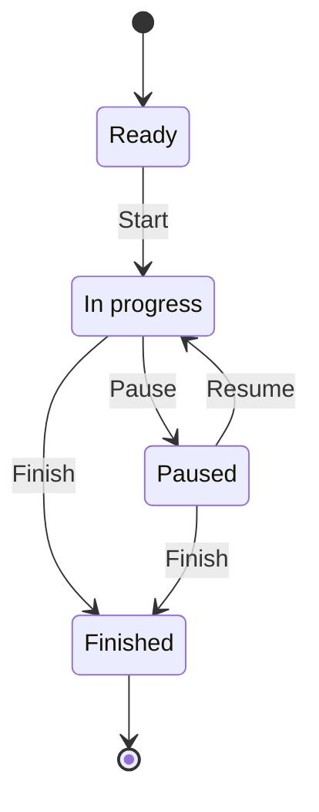

# gym assystant — draft specification

Status: revision 17, for exploration. Only a disposable browser mockup is authorized. Android implementation starts after the user decides the scope. Mockup coverage does not mean a production requirement is implemented.

## Purpose

Follow a training program made of multiple training sessions. During each session, prioritize logging repetitions and weight, time execution and recovery, retain machine setup notes, and offer secondary access to an exercise video. Review performance across comparable sessions and see which session is planned today and on future dates.

## Requirements and acceptance criteria

| ID | Requirement | Acceptance criteria |
| --- | --- | --- |
| GYM-001 | Select exercises within a session. | Each session shows its exercises. Selecting an exercise opens its own log; back returns to the correct session. |
| GYM-002 | Secondary in-app exercise video access. | A small button below logging, timers, and setup opens the selected exercise's video panel. No large thumbnail or autoplay. The mockup labels the panel as a non-playable placeholder with a neutral decorative video frame. Actual video playback is deferred. |
| GYM-003 | Record seat position per exercise occurrence. | Free text persists while navigating during the mockup visit. Separate sessions have separate notes; cross-session carryover is undecided. |
| GYM-004 | Record reps and weight for each set. | Reps are prominent and appear before weight. Reps accept nonnegative integers; kg accepts nonnegative finite numbers. Invalid input restores the last valid value. Values remain associated with the exercise occurrence. Sample values are not prescriptions. |
| GYM-005 | Mark sets done and undone. | Completion counts update in exercise and session views. This remains a proposed production behavior. |
| GYM-006 | Explore a responsive dummy mockup. | Narrow phone and desktop layouts, visible prototype disclosure, keyboard access and focus restoration. All app-owned popups, including video and folder dialogs, stay within the simulated phone display on desktop and mobile. Modal cards are centered in that display with at least 16px edge spacing; only the phone is dimmed, and the surrounding presentation stays undimmed. Long dialog content scrolls inside the card rather than escaping the phone. Retain native modal focus trapping, Escape/close/backdrop dismissal and trigger focus restoration; adapt to resize and page scrolling without changing app data. The overflow menu remains anchored inside the phone header. These are production-style mockup presentations, not native Android delivery. Edits and timers are in memory and reset on reload; statistics are labeled fictional history. |
| GYM-007 | Name the app gym assystant. | Browser title and visible branding use this exact spelling. |
| GYM-008 | Center the app on a training program containing sessions. | Home identifies the active program; its session templates are accessible through the calendar and upcoming agenda. The initial sample still has three distinct templates. Each defines ordered exercises, number of sets, and target rep ranges. Selecting a session shows those prescriptions separately from actual logged sets. Train, Plan, and Progress are persistent bottom navigation destinations; Settings is reached through the top-right overflow menu. Train opens dated workouts; Plan edits their reusable templates. |
| GYM-009 | Prioritize performance logging. | Exercise screen order: back navigation, compact execution/recovery timers at the top, exercise and prescribed target, one combined warm-up/working-set list with reps/weight controls and an inline Add warm-up action, machine setup, small video button. Set controls are visible before video access at mobile width. |
| GYM-010 | Show training performance statistics. | A Progress view lets the user select an exercise and metric. Lead with dated history for best reps at a fixed weight, heaviest weight at exactly 10 reps, and volume load; also retain completed working-set count for the displayed period in “How to compare”. Values are computed from explicit fictional completed logs, not hardcoded chart labels. No comparable data means a gap, not zero. Details and comparison rules are available in “How to compare”. |
| GYM-011 | Research progression metrics before finalizing analytics. | A linked literature brief distinguishes outcomes, workload, and consistency; cites original research and evidence syntheses; records limitations, formulas, and proposed versus included metrics. Research recommendations do not automatically authorize features. |
| GYM-012 | Time execution and recovery separately. | Execution counts up; recovery counts down from the selected planned exercise's recovery duration (whole seconds, 1–3600; default 90). Set this duration in Plan → plan session → exercise prescription and save it with the plan; the workout displays it read-only. New or untouched previews use the saved prescription, while protected dated workouts retain their original duration through later edits, plan switching and exercise reordering. Each has start/resume, pause, and reset. Recovery stops at zero and announces completion. Timers use elapsed clock time, retain independent state when switching modes/views, and belong to the selected exercise occurrence. Reload resets them. No automatic set completion or automatic transition. |
| GYM-013 | Use an inviting, evidence-informed brand. | Retain the exact name gym assystant. Use the promise “Your pace. Your progress.”, clear next actions, personal progress feedback, and neutral language for rest or unfinished sets. Apply the sunrise-amber, deep-teal, and ivory palette, wordmark, and tone documented in branding-research.md. Warm accents emphasize action, calmer teal surfaces support logging/recovery, and text/control contrast remains readable. No shame, body-transformation promises, streak pressure, or unsupported claims that colors increase exercise adherence. |
| GYM-014 | Track warm-up reps alongside working sets. | Add/remove warm-up sets; edit nonnegative whole-number reps and nonnegative finite kg; mark each done/undone. Show warm-up and working sets together in one list, with a visible type label on every row. Keep their data distinct, retain them when navigating, and exclude warm-ups from working-set completion, records, and all GYM-010 metrics. |
| GYM-015 | Follow Android Material 3 UI conventions. | Use shared Material button styles by emphasis: filled for workout opening, Start/Resume/Finish, timer Start/Pause/Resume, and Save; filled tonal for Plan Add actions; outlined for Pause and for Finish while Paused; text for the inline warm-up action, Today, Reset, and secondary video access. Use standard circular icon Back controls on secondary screens. Use circular icon buttons with consistent 24-pixel SVG icons and accessible action labels for week navigation, 48px exercise drag handles, template removal, and set completion (selected fill plus pressed state). Labels are centered, sentence case, and 14 pixels with medium weight; regular actions have consistent padding and full rounding. Hover/pressed/focus/disabled states are visible, and disabled controls remain inactive. Use joined segmented selectors with a check icon and tonal selected fill, rounded cards and dialog, an icon-and-label bottom navigation bar with a selected indicator, and at least 48 × 48 CSS-pixel touch areas for standard controls in the phone mockup. Calendar date cells adapt their width to fit seven columns, retaining at least 48 pixels of height. Keep navigation outside the scrolling content. Real Android delivery must use dp and native Material components. Document official guidance in android-ui.md. |
| GYM-016 | Schedule sessions and browse dated workouts. | Train initially selects today. Selecting a calendar date updates the existing top card with that date, its session (or “No session planned”), and an action opening that dated workout; no popup opens. Previous/next week and Today update the same card. All seven Monday–Sunday dates fit in one row without horizontal scrolling. Upcoming-session taps select that date in the same card. Weekly assignments and individual-date overrides are edited in Plan, not in the execution card. The sample starts with A on Monday, B on Wednesday, C on Friday. Dated logs stay isolated. Future dates say “Preview session”; today/past dates say “View session”. Reload resets edits. |
| GYM-017 | Start, pause, resume, and finish a session. | Each dated session has Ready, In progress, Paused, or Finished state. Start session changes Ready to In progress; Resume session changes Paused to In progress. Both open the first exercise with unfinished working sets in the chosen order, or the first exercise for review if all sets are logged. Pause session changes In progress to Paused, pausing both timers for every exercise and retaining sets, warm-ups, seat notes, and order. Finish session is available from In progress or Paused, pauses all timers, records an in-memory finish timestamp, and changes to Finished. Pause/Finish are accessible from session and exercise screens while applicable. Finishing is allowed with fewer sets or no logged sets and never marks remaining sets done or creates attendance. Logging all sets does not automatically finish the session. Finished has no Start/Resume transition; its state and total set count are each displayed once. Its logs and targets are readable, while edits, set toggles, warm-up changes, exercise order, and timer running/reset/duration changes are disabled with unavailable action controls hidden; timer-mode selection remains available for reviewing elapsed times. Paused sessions cannot start timers until Resume; Resume does not restart timers automatically. Navigation does not alter lifecycle. Future workouts retain preview context and cannot record real attendance. Lifecycle is isolated by date; reload resets it. Attendance remains separate under GYM-020; persistent history and reopening finished sessions are deferred. |
| GYM-018 | Manage a training plan separately from execution. | Plan opens a library of named programs; selecting one edits its name; 1–7 named session templates with optional focus descriptions; catalog exercises with add/remove/reorder; working-set counts (1–10) and rep ranges (1–50, min ≤ max); assignments for each weekday; and optional today/future date assignments or “Use weekly pattern”. Edits are drafts until Save plan validates and applies them. Session templates require at least one exercise. Plan contains prescriptions and schedule controls, not completed sets, actual weights/reps, timers, or lifecycle actions. Train contains dated execution. In progress, Paused, or Finished sessions and sessions with recorded entries or an adjusted execution order retain a copy of their original prescription; newly opened untouched previews use the saved plan. Removing a template clears its weekly/date assignments but retains existing execution records and access to them. State resets on reload. Each planned exercise includes Recovery (s), a required whole number from 1 to 3600, default 90. It remains a draft until Save and follows existing validation, plan isolation and dated snapshot rules. |
| GYM-019 | Reorder exercises within a dated workout when machines are busy. | The Train session list offers a 48px drag handle for each exercise, including before Start and while In progress or Paused. Replace sorting arrows with mouse/touch drag-and-drop and a visible insertion position. Dragging starts only from the handle so normal scrolling, selection and form editing remain intact. Autoscroll inside the phone content near its edges; release commits the new position, while Escape or pointer cancellation retains the original order. Keyboard users focus the same handle and press ArrowUp/ArrowDown to move one place; attempts beyond list boundaries do nothing. Finished sessions have no reorder handles. Reordering changes only this dated occurrence, never its reusable plan or another date. Exercise identity, prescribed targets, working/warm-up sets, completion, seat notes, and both timers remain attached to the same exercise; running timers continue. The current exercise selection is preserved. Start/Resume chooses the first exercise with unfinished working sets in the chosen order. The adjusted order survives navigation, Pause/Resume, and plan saves, including a reordered Ready preview; reload resets it. Accessible labels identify the exercise, keyboard instructions accompany the handle, and an announcement confirms its new position. Use the same drag-handle interaction for reusable exercise prescriptions in Plan, where the result remains a draft until Save; retain expanded/collapsed editing state and field values during reordering. |
| GYM-020 | Account for missed dates and delayed attendance. | Retain each occurrence’s original planned civil date separately from the actual first day with a valid completed working set. A valid logged set has positive whole-number reps and finite nonnegative kg; warm-ups, previews, edits, and Start alone do not prove attendance. Past unlogged sessions remain pending unless explicitly Finished; Train shows up to three oldest pending sessions from the last 28 past days with access to their original workout. Future dates stay as planned; no automatic shifting. Logging an overdue workout today records today as its actual attendance date, retains the planned date, and removes it from the pending list. Pause/Resume or multiple sets do not count attendance twice. Progress adds a separate attendance panel for planned occurrences in the previous 28 complete days, updated through today: logged/planned count and percentage, logged on the planned day, logged later, logged earlier, not yet logged (including Finished without a valid working set), and mean days late among late occurrences. Future and today’s still-open plans are excluded from this denominator; zero planned occurrences means N/A. Planned dates/names in this past cohort are snapshots and cannot be erased retroactively by plan edits/deletion. Plan date assignment accepts today/future dates; retrospective corrections remain deferred. Attendance uses clearly labeled fictional observations plus this visit’s logs, resetting on reload. Unlogged means unknown attendance, not proof of absence; no reasons, streak penalties, or strength zeros. Performance charts retain actual observation dates and never insert missed sessions as zero performance. |
| GYM-021 | Minimize every page around the user’s next action. | Review Train, Ready/In progress/Paused/Finished sessions, execution/recovery logs, finished-log review, video, Plan, template editing, and Progress by performing real browser interactions. Keep the top calendar card and fitted week. Remove repeated program/category headings, dates, generic instructions, duplicate completion totals, and repeated prototype footers. Session state and total working-set completion appear once; show actual attendance date only when different from the planned date. Lifecycle buttons use concise Start/Pause/Resume/Finish labels with full accessible names; the exercise header uses icon Back. Timer modes/time/controls stay at the top in a compact panel; routine timer status remains announced without extra visible prose. Set targets and values retain emphasis; Add warm-up is beside the set heading, and warm-up removal uses a labeled icon inside its own row. Finished review hides inapplicable controls while retaining readable values and timer-mode review. Plan exposes names, session summaries, Save, and meaningful draft/error feedback; weekly/date settings and optional focus expand on demand. Template prescriptions show exercise/target summaries with the first editor open by default; all edits/order/removal remain accessible. Progress leads with exercise selection and the performance chart, followed by a compact attendance summary including late and unlogged counts. Detailed formulas, matched contexts, working-set count, attendance timing/definitions, and data limitations remain in labeled expandable sections. Keep one global demo/reset disclosure in the phone UI and identify sample performance and sample/live attendance at their point of use. Shorten the video placeholder without pretending it plays. Retain 48px standard targets, keyboard disclosure behavior, all authorized features, and spec/code mappings. |
| GYM-022 | Settings for app language and theme. | A persistent top-right vertical three-dot icon opens an anchored overflow menu containing Settings. Selecting it opens the separate Settings screen; bottom navigation contains only Train, Plan, and Progress and has no selected destination while Settings is open. A Back icon returns to the prior screen and its scroll position without changing drafts, logs, exercise selection, or timers. The overflow icon and menu item have accessible names and 48px targets. Click outside or Escape dismisses the menu; Escape restores focus to the trigger. Support keyboard opening, arrow-key item focus, Enter activation, and Tab dismissal without a focus trap. The popup stays within the phone at narrow widths and in both themes. Language offers System default, English, Italiano, and Español, with automatic selection for English, Italian and Spanish system-language variants (for example es-ES/es-MX) and English fallback for unsupported system languages; native delivery localizes all app-owned text/date/number presentation and keeps user-authored names/notes unchanged. The mockup previews translated Settings and navigation only and explicitly discloses remaining English demo screens. Theme offers System default, Light, and Dark; applies immediately across all views without changing entries or interrupting timers; System responds to system color-mode changes. Keep the amber/teal brand, readable contrast, 48px controls, and concise grouped settings. Choices reset on reload in the mockup. |
| GYM-023 | Choose a durable app-status save folder. | Settings shows the current save location and a Change folder action. Native Android uses the system directory picker and retained document-tree permission rather than an arbitrary typed filesystem path; users may select any writable folder exposed by the picker, subject to Android restrictions. Cancellation retains the previous choice; inaccessible/revoked storage reports unsaved status and offers retry/change location without discarding in-app data. Native delivery saves versioned UTF-8 JSON snapshots after committed plan, settings, log, setup, order, and lifecycle changes and on timer pause/background, not every clock tick. Keep a previous valid snapshot and only report saved after a complete write; details of atomic replacement depend on the document provider. User-visible snapshots are independent of app-private storage and readable without the app. The browser previews example folder choices, labels them as previews, writes no folder, and offers an actual Download status JSON snapshot using browser downloads. Saving/reloading/restoring and Android folder access remain unimplemented in this mockup. |
| GYM-024 | Download statistics and recover data without the app. | Settings provides Download statistics CSV plus full status JSON and a plain-text recovery guide. CSV contains all three sample performance series, sample/live attendance records and the same 28-day summary shown in Progress, independent of the currently selected exercise/metric; current editable sets remain excluded from sample performance. Use documented UTF-8, RFC 8259 JSON and RFC 4180-style CSV with headers, comma delimiter, escaped quotes, CRLF records, stable English field names, decimal points, explicit units, ISO civil dates and UTC timestamps. Missing observations remain null/blank with a reason, never strength zeros. Separate sample records from this visit's demo edits. Full JSON contains saved plan, distinct unsaved draft, catalog/context, dated execution snapshots and order, working/warm-up sets and seat notes, lifecycle/attendance, past obligation snapshots, sample histories, settings, and paused elapsed timer snapshots with captured-running metadata; export must not mutate live timers. Include format/version and a data dictionary; the guide explains reading JSON with a text editor/Python and CSV with a spreadsheet without app dependencies. Document future format migrations; no proprietary binary-only backup, encryption/password requirement, cloud account, import UI, notifications, or new metrics are introduced. Native persistence and restoration remain future delivery. |
| GYM-025 | Keep design elements consistent across every screen and state. | Walk through Train, Ready/In progress/Paused/Finished sessions, execution/recovery and warm-up logging, finished review, video, Plan/schedule/template editing, Progress and its details, Settings/files/folder, and overflow in both themes and at narrow widths. Use the same 48px circular Back icon and compact heading alignment for secondary pages, with clear accessible destination labels. Keep filled/tonal/outlined/text action hierarchy and move/delete distinctions. Plan Save is disabled until a draft change and returns to disabled after saving. Finished set completion is a static check/dash with complete/not-logged accessible text, not an inactive button that looks tappable; read-only values stay readable and lose editable-field outlines. Numeric inputs retain number validation, touch size and keyboard editing but hide browser-specific spinner decorations. The unavailable video uses a neutral decorative video frame rather than a play affordance. Empty optional session focus does not produce a leading separator. Every expand/collapse control uses a full-width row at least 56px high, a readable 14px label, and a visible 24px chevron in a 48px circular indicator on the right; the whole row toggles the section. The chevron turns upward when expanded. Use the same treatment for plan schedules, optional focus, exercise prescriptions, metric/attendance details, and file details. Retain native keyboard and expanded-state semantics, label wrapping at narrow widths, and both themes; the visual indicator must survive language changes. Retain exercise emphasis, warm-up/working distinctions, all existing data/lifecycle behavior, and document before/after findings. No new product capability or Android implementation is introduced. |
| GYM-026 | Create, browse and activate multiple named training plans. | Plan opens a list of saved programs and retained unsaved new-plan drafts. Show each name, session count, and a single Active badge; inactive saved plans have a Use plan action. Selecting a saved plan opens a read-only preview with Back to the library. Edit explicitly unlocks its fields and sorting/add/remove actions; navigation into a session template can review it without enabling editing. Save commits the draft and returns to read-only mode. Back retains unsaved drafts but does not commit them. New plans created by Add plan begin editable. Retained drafts are clearly marked as unsaved, even when previewed read-only. Add plan creates a distinct draft with one illustrative session/exercise and no weekday assignments; name, prescriptions and schedule use existing GYM-018 validation. Save commits it without silently activating it; existing edits remain drafts until Save. Seed two clearly fictional, distinct programs to explore switching. Exactly one saved plan is active. Use plan first opens a phone-contained confirmation naming the selected saved plan and explaining its effect on untouched future sessions. Cancel, Escape and scrim dismissal retain the current active plan and all drafts, logs and timers; the confirmation action alone activates it. Use plan activates only a saved version; if its draft has changes, show a concise request to save first, retain the draft and do not activate. Switching plans or browsing editors never discards per-plan drafts. Stable plan IDs and globally unique template/entry IDs prevent cross-plan collisions; renames never alter identity. Activation changes only today's/future untouched schedule, not past obligations. Dated workouts already started, paused, finished, edited or reordered retain their original plan name/revision, prescriptions, sets, warm-ups, notes, order and timers and remain accessible on their date; they take precedence over a newly active plan on that date. Untouched Ready previews follow the active saved plan. Identify an original-plan workout when it differs from the active plan. Pending old-plan sessions remain available and keep original planned dates; attendance denominators/observations survive activation without inventing retroactive sessions for a newly active program. Progress keeps the existing exercise comparison/attendance semantics and no extra metrics. Version-2 JSON includes all saved plans, activePlanId and separate per-plan drafts; executions/obligations/visits and CSV retain explicit program IDs. Document how version-1 files map to version 2; no import UI, plan deletion/duplication, automatic rotations, production persistence or Android code are added. Reload restores fictional defaults. |

## GYM-006: mockup-only view references

Place a compact text reference strip outside and above the phone frame. Text is selectable when no native dialog is open; native modal focus/interaction rules take precedence while a popup is open. Show the current view's stable unique ID and a readable name, so feedback can refer to a view and its particular element (for example, “VIEW-003: make reps larger”). Include all full-screen views, all dialogs and the overflow menu. Opening a popup displays that popup's reference; closing it restores the underlying screen's reference. Navigation, Back, language/theme changes and reload preserve the assigned IDs. Repeated exercises, plans and session lifecycle states share their screen's ID rather than generating new IDs for user data.

| Reference | View | Existing DOM anchor |
| --- | --- | --- |
| VIEW-001 | Train | `program` |
| VIEW-002 | Session | `session` |
| VIEW-003 | Exercise | `exercise` |
| VIEW-004 | Plans | `plans` |
| VIEW-005 | Plan editor | `plan` |
| VIEW-006 | Plan session editor | `planSession` |
| VIEW-007 | Progress | `progress` |
| VIEW-008 | Settings | `settings` |
| VIEW-009 | Video preview | `videoDialog` |
| VIEW-010 | Save folder preview | `folderDialog` |
| VIEW-011 | More options | `overflowMenu` |
| VIEW-012 | Activate plan | `activatePlanDialog` |

Register new views with unused IDs; do not renumber or reuse existing references. The strip remains readable without overlap, wrapping or horizontal scrolling at 320/390/430px and on desktop. Reserve space outside the simulated display rather than overlaying app controls; retain fitted calendar, bottom navigation, phone-contained popups and keyboard/modal behavior. Development reference names stay in English regardless of the app's preview language. References belong only to the disposable presentation: they do not change app state, exported data, or the future native Android interface.

## Information model and navigation

`Training plan → reusable session template → dated execution snapshot → actual working/warm-up sets`

Plan prescriptions and execution entries have separate data objects. Stable session IDs connect schedule assignments to templates; renaming or deleting another template does not change those IDs. Execution copies the program name, session name, ordered prescriptions, and plan revision. Edits to actual sets, seat notes, or timers never change the plan.

An untouched Ready preview can be refreshed from the saved plan when reopened. Starting it, recording any entries, or adjusting its execution order preserves its snapshot for subsequent visits. The Train calendar prioritizes an existing recorded/started workout for that date even if its template is later changed or removed. Exercise-performance statistics still use fictional immutable data. Attendance additionally uses this visit’s valid logged working sets, with original planned dates frozen for the recent past; saving real history across reloads remains deferred.

Navigation: Train/calendar → dated Session → Exercise; Plan → plan library → selected plan editor → template editor; Progress → statistics; top-right ⋮ → Settings → language, appearance, save location, and exports → Back to the previous screen. The sample catalog remains small and illustrative. Plan controls add/remove/reorder prescribed exercises. Train permits reordering the dated workout separately; actual session warm-ups retain their existing controls. Multiple plans are included under GYM-026. Importing, automatic rotations, and cross-reload history remain unimplemented in the mockup. GYM-023 specifies native persistence for the later Android phase.

## GYM-017: session state diagram

States describe the session; button names describe actions. “Finished” means the user ended the workout, including a partial workout, rather than claiming every prescribed set was completed.

| State | Meaning | Available lifecycle actions |
| --- | --- | --- |
| Ready | Session has not been started. | Start |
| In progress | Workout is underway. | Pause, Finish |
| Paused | Workout is temporarily interrupted; entries and timers are retained. | Resume, Finish |
| Finished | Workout has ended; recorded information can be reviewed. | None |

Exercise selection remains navigation, not a fifth lifecycle action. Ready and Paused previews retain their existing logging controls; Finished is read-only. Timer controls remain independent, except Pause and Finish stop all running occurrence timers.

## GYM-010: metric definitions

| Metric | Definition | Interpretation |
| --- | --- | --- |
| Reps at reference weight | Highest completed working-set reps at the selected exercise's displayed reference kg, per dated occurrence. | Repetition performance at comparable load. Reference weights are fixed sample assumptions, not recommended loads. |
| Weight at 10 reps | Highest completed working-set kg with exactly 10 recorded reps, per dated occurrence. | Load performance for a fixed repetition task; not a 10RM claim unless maximal effort was actually established. |
| Volume load | Sum of `kg × reps` over completed working sets of that exercise in each dated occurrence. Unit: kg·reps. | Workload proxy, not mechanical work, strength, or muscle growth. |
| Completed working sets | Count of completed, non-warmup sets with positive whole-number reps and valid nonnegative weight for the exercise over the displayed period. | Training exposure, not a direct outcome measure. |

Statistics include only completed working sets with positive whole-number reps and finite nonnegative weights; zero-rep entries are placeholders, not performance observations. Compare only identical exercise, machine identity, setup, unit/load convention, range-of-motion protocol, and effort context. The fictional history uses the same setup and a stated 2-reps-in-reserve context. Actual effort collection is not implemented; without it, future real comparisons must be labeled unadjusted. A changed setup must not silently merge histories. Missing baselines or zero baselines do not produce percentage gains. Charts show actual dates, units, raw values, and gaps. No aggregate strength score across unrelated machines.

The Progress view explicitly excludes the current editable session: four past fictional occurrences are used to explore the design. Editing today's samples must not rewrite that history. Saving completed sessions to history is a future implementation decision.

## GYM-012: timer assumptions

Manual stopwatch and countdown controls are mockup choices, pending exploration. Recovery duration is prescribed per exercise during planning, not edited during execution. New planned exercises default to 90 seconds. Saving a changed duration updates new or untouched previews; started, logged or reordered snapshots retain their original target and timer state. Reset stops the selected timer and restores zero (execution) or that occurrence's prescribed duration (recovery). Resuming a finished recovery starts a fresh interval. No sound, vibration, background service, notifications, or timing history is included. Browser rendering can pause in the background; elapsed time is recalculated on return. Native Android background/lock-screen behavior remains undecided.

## GYM-016: calendar assumptions

Today follows the browser/device local date. The week starts Monday. Civil-date calculations preserve calendar dates across daylight-saving changes and month/year boundaries. The weekly sample is an exploration assumption, not a recommended training frequency. Saving a date assignment in Plan changes only that date; there is no drag/drop, automatic rescheduling, scheduling notification, or integration with an external calendar.

The week is a seven-column grid with all dates visible. On narrow previews, date cells may be less than 48 CSS pixels wide to satisfy the requested fit; they retain generous height and never overlap. Standard controls keep their existing touch targets. The agenda considers future dates strictly after today and shows up to three planned occurrences within the next 28 days. If there are none, show a clear empty state. Past plans are not declared completed; scheduling and actual performance are different concepts. Finishing working sets does not persist history or automatically reschedule the plan. Attendance is recorded in memory under GYM-020 without changing the GYM-017 lifecycle or treating Start as attendance.

## GYM-020: attendance definitions

The pending default is a mockup design assumption pending user preference. The previous 28 complete local civil days form the planned cohort; observations are accepted through today, so catching up increases the cohort’s logged count without rewriting its original due date. Delay is the civil-day difference `actualDate − plannedDate`; late means positive delay. Attendance percentage is `logged / planned × 100`, rounded for display. Average delay is `sum(positive delays) / late count`; no late observations means N/A. “Logged” means at least one valid completed working set, not necessarily a full prescribed session. Set completion and session attendance remain separate constructs. The historical attendance fixture contains the four Session A observations underlying performance history and two additional fictional Session B visits; it does not invent exercise measurements for those extra visits. The past-plan snapshot also retains the exercise prescriptions needed to open an overdue workout after its template changes or is removed.

## Deferred decisions and exclusions

- Importing, automatic rotations, and adding/removing working sets during execution. Plan template/schedule editing and execution warm-ups are now included.
- Primary training outcome: strength, hypertrophy, or general progress; optional RIR logging and estimated 1RM are research proposals only.
- Video source, licensing, language, offline access, and machine-specific variations.
- Seat carryover, accounts, unit preferences, and per-side/total weight conventions. Text backups and native folder saving are now specified in GYM-023–024.
- History editing, native storage implementation details under GYM-023, reopening a Finished session, a plan revision history UI, and Android technology. Snapshot revision tracking is included to protect execution data.
- Timer auto-transitions, per-set recovery variation, background reliability, alerts, and historical execution/rest analytics. Per-exercise recovery prescriptions are included in GYM-012/GYM-018. GYM-024 only captures current timer readings in status snapshots.

Statistics, attendance tracking with pending catch-up sessions, timers, calendar planning, and a separate plan manager are now in scope, superseding earlier exclusions. Social features, subscriptions, coaching, and notifications remain outside scope. No load-increase advice or personalized training prescription is implemented.

## Repository locations

The disposable mockup and its checks live in `prototypes/web/`. The future Android project location is `android/`, which currently contains documentation only. Specifications, research, design guidance, and review artifacts have distinct folders under `docs/`. The [repository layout](../architecture/repository-layout.md) records this organizational decision; it adds no product feature and starts no Android implementation.

## Change and traceability rules

Write or update requirement IDs before changing features. Code anchors, `data-req` attributes, and [traceability.md](traceability.md) provide both mapping directions and verification. Tests check meaningful behavior, not merely presence of IDs. Traceability supports review; it cannot guarantee correctness by itself. Android delivery remains distinct from mockup delivery.

## GYM-022–024: Settings and durable files

See [data-formats.md](../architecture/data-formats.md) for the version-2 interchange contract (with version-1 recovery notes) and recovery instructions. The native persistence requirement supersedes earlier persistence deferral only for the eventual Android app; this disposable mockup still resets on reload and does not restore downloads. All Android delivery remains not started. Full localization is native scope; the prototype demonstrates the choices through Settings and navigation.

Native language/theme choices follow Android's [per-app language guidance](https://developer.android.com/guide/topics/resources/app-languages) and [system/light/dark theme guidance](https://developer.android.com/develop/ui/views/theming/darktheme). Folder selection follows the [Storage Access Framework](https://developer.android.com/training/data-storage/shared/documents-files); a document-tree URI is an access handle, not a portable directory path. A restored file must ask for access again rather than assume exported permission metadata grants access.

## GYM-026: multiple-plan boundaries and deliberate changes

The library distinguishes read-only browsing, explicitly unlocked draft editing, saving and confirmed activation. One active program supplies the unrecorded calendar. Existing protected workouts and past obligations take precedence by date and never become workouts from the new program. A new plan begins influencing the schedule only when explicitly activated; it creates no past attendance obligations. A pending session's plan ID connects it to its original prescription even while another plan is active. Session IDs are globally unique across saved plans and retained drafts.

The [text-file contract](../architecture/data-formats.md) moves to version 2 to store the library without dropping inactive plans or unsaved drafts. Native Android delivery remains not started.
